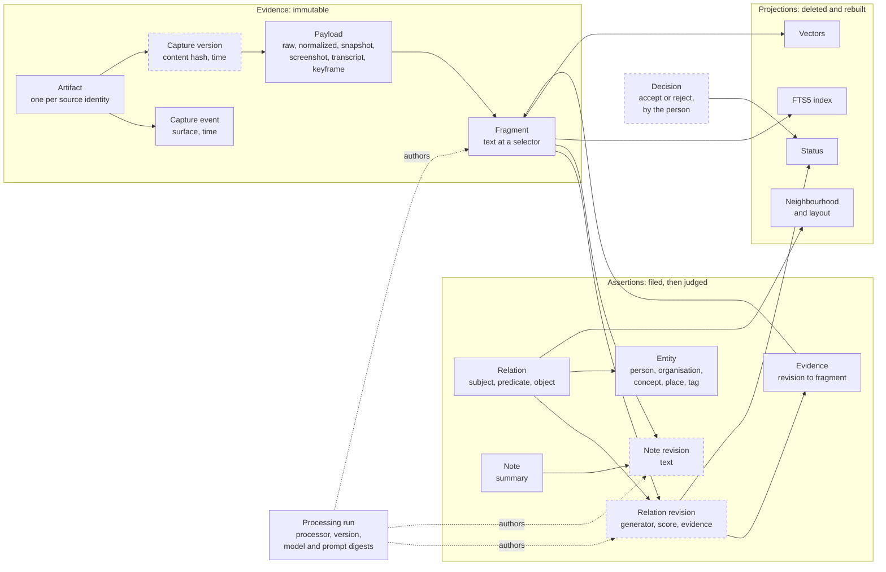
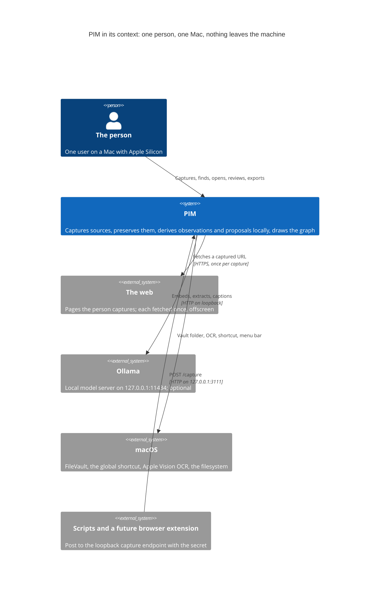
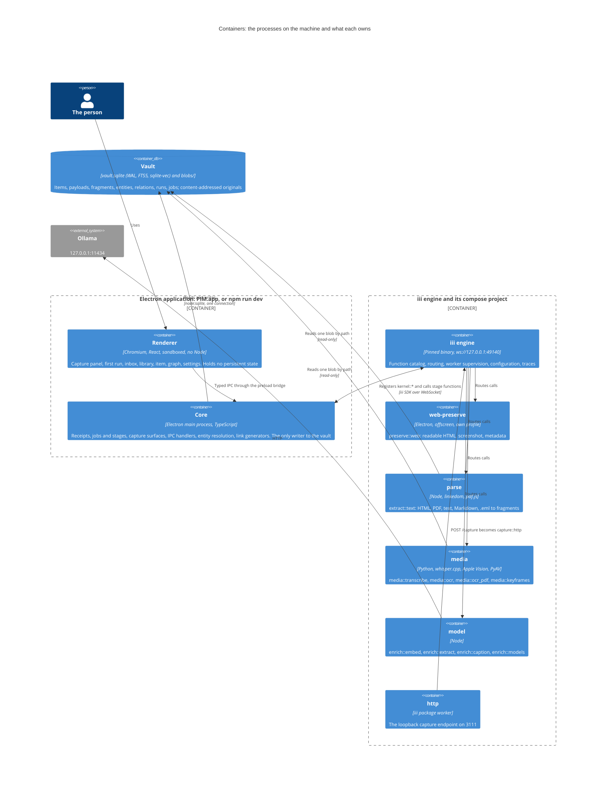
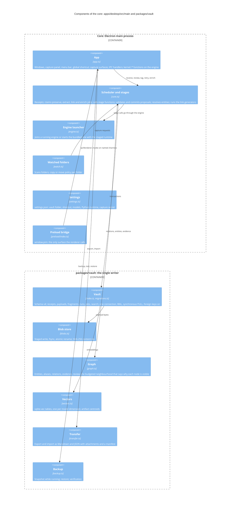
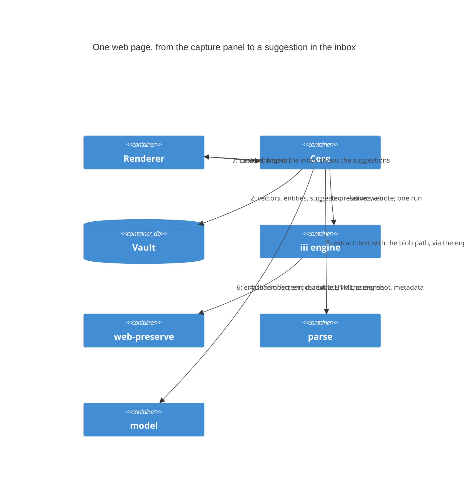
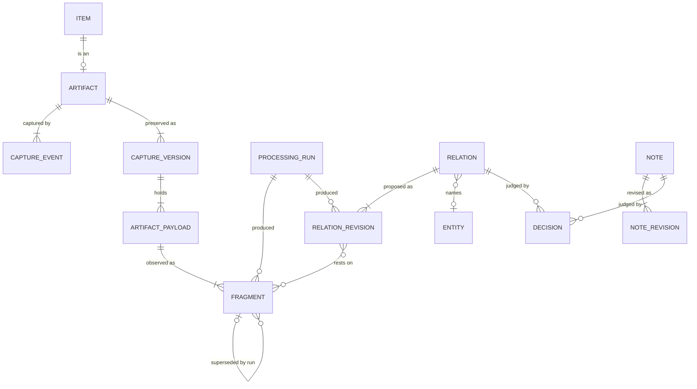

# PIM architecture

Nov 8, 2026 · @Areg

**Status:** Proposed, 2026-11-08. Describes the system as built at commit 9eaf7c9 (vault schema v4) and marks the target where the repair plan changes it (schema v5, ADR-006; the job protocol, ADR-007). Restructured from the approved specification v1.0 (`archive/specification-v1.0.md`, sections 4 to 9). The two embedded diagrams of v1.0 did not survive its export; they are replaced here by C4 diagrams in Mermaid, which GitHub renders.

This is the third document in the lineage. The requirements (`01-requirements.md`) say what must be true; the intent (`02-intent.md`) says by what idea; this document says how the idea is laid out: the concepts and how they relate, the processes and what each owns, the modules and what each hides, the contracts that compose them, and the evidence that the whole still expresses one idea.

## 1. The concepts and how they relate

The concept map is the ledger and the court drawn as data. Solid boxes exist in schema v4. Dashed boxes are proposed in ADR-006 for schema v5 and are what the ledger needs to stop losing history.

Reading the map: an artifact is captured, perhaps several times, into payloads; a parser observes payloads as fragments; a processor files relations and notes that rest on fragments; the person decides; status, the indexes and the graph are computed from the rest and can be thrown away. In v4 the dashed boxes are collapsed into their parents: a relation holds one generator and score (the latest run overwrites), a note holds one text (overwritten), a decision is the `status` column, and a URL captured again is a no-op.

## 2. System context

Three facts about the context decide most of the architecture. The person is alone, so there is no sync and one writer. The machine is the trust boundary, so loopback is the only network and the disk's protection (FileVault) stands in for encryption in v0.1. Ollama may be absent, so every path that does not need a model must work without one (PRS-8), and model work runs last.

## 3. Containers

A container here is a process with its own lifetime. PIM runs as two Electron processes plus an engine and its workers, all on one machine.

The table below is binding. "Owns" is the state a container may change; "Must not" is the rule whose violation is a decision delta (AGENTS.md, section 5), not a bug fix.

| Container                  | Technology                                                      | Responsibility                                                                                                                                                                                     | Owns                                                     | Must not                                                                           |
| -------------------------- | --------------------------------------------------------------- | -------------------------------------------------------------------------------------------------------------------------------------------------------------------------------------------------- | -------------------------------------------------------- | ---------------------------------------------------------------------------------- |
| **Core** (main process)    | Electron main, TypeScript, `node:sqlite`                        | Receipts and preservation state; the job table and the stage scheduler; committing proposals; entity resolution; the deterministic link generators; capture surfaces; IPC handlers; the vault lock | `vault.sqlite`, `blobs/`, `settings.json`, the job table | Parse untrusted content or run a model in-process; accept a decision from a worker |
| **Renderer**               | Chromium, React, Vite; context isolation, sandbox               | The screens; all state through IPC; the ForceAtlas2 layout (to move to a worker thread in R1)                                                                                                      | View preferences only                                    | Reach Node, the filesystem or the network; hold a database handle                  |
| **Preload bridge**         | Electron preload                                                | The one IPC surface the renderer sees (`window.pim`)                                                                                                                                               | Nothing                                                  | Expose `ipcRenderer` or any raw channel                                            |
| **iii engine** and compose | Pinned binary and `infra/worker-compose.yaml`                   | The catalog of every function, routing, worker supervision and restart, worker configuration, traces                                                                                               | The live registry, the compose file, the engine version  | Hold canonical state; keep content in traces                                       |
| **web-preserve**           | Electron, offscreen window, throwaway profile                   | Load a URL once with no Node and no shared session; return readable HTML, a full-page screenshot and metadata                                                                                      | Its temporary profile                                    | Share the app's session or origin; write anything                                  |
| **parse**                  | Node, linkedom, pdf.js, `@pim/blocks`                           | HTML, PDF, text, Markdown and `.eml` to fragments with selectors                                                                                                                                   | Extractor versions                                       | Touch the vault; write anything                                                    |
| **media**                  | Python, whisper.cpp (pywhispercpp), Apple Vision (pyobjc), PyAV | Transcription with timed fragments; OCR with boxed fragments; keyframes at scene changes                                                                                                           | Model binaries and their digests; its scratch directory  | Network access; write anything but its scratch files                               |
| **model**                  | Node                                                            | Embeddings, schema-constrained extraction and captions through Ollama; report which models answer                                                                                                  | Prompt templates and their digests                       | Decide adoption status; call anything but Ollama on loopback                       |
| **http**                   | iii package worker (`api.workers.iii.dev/http`)                 | The loopback capture endpoint, `POST /capture` with the per-install secret, forwarded to `capture::http` on the core                                                                               | Nothing                                                  | Bind anything but 127.0.0.1                                                        |
| **ade** (development only) | iii package worker, port 3114                                   | The engine's console: traces, logs, workers; not in the packaged app                                                                                                                               | Nothing                                                  | Run in the packaged app; be started when not needed (it binds all interfaces)      |

Two departures from v1.0 are already recorded in the milestone log: there is no link-and-layout worker (candidates are computed in the core from the vault; layout runs in the renderer), and the parse and media workers read a blob by path on the same machine instead of receiving bytes over the bus. The second is a wide interface (section 6) and v0.2 narrows it to a scoped handle.

## 4. Components of the core

The core is where the concept is enforced, so it is the one container drawn at component level.

**Renderer screens**, for completeness: the capture panel (a floating window on the shortcut), first run, inbox, library, item (source viewer, derived panel, connections), graph (Sigma.js with dimension toggles, a details panel, table and timeline projections), settings, and a runtime status view. They are React components under `apps/desktop/src/renderer/src/screens` and speak only to `window.pim`.

**Other packages**: `@pim/contracts` (every cross-process shape as a Zod schema, exported to `contracts/*.json`); `@pim/worker-kit` (the TypeScript worker bootstrap: register, health, structured logs, graceful stop); `@pim/blocks` (the one rule for "the nth block of an HTML document", shared by the parse worker and the viewer so a block selector written by one resolves in the other).

## 5. Decomposition: who owns which decision

A boundary is justified by the invariant it protects, the change it isolates, and an execution traced across it. The table states, for each part, what it decides, what state it controls, what it hides from everyone else, and what everyone else may rely on.

| Part                 | Decides                                                                    | Controls                                       | Hides                                                                        | Others may rely on                                                                                                         |
| -------------------- | -------------------------------------------------------------------------- | ---------------------------------------------- | ---------------------------------------------------------------------------- | -------------------------------------------------------------------------------------------------------------------------- |
| Vault                | What is canonical, what is derived, what a migration does                  | The schema, every row, the blob directory      | SQL, table layout, FTS and vector tables, the blob path scheme               | Ids never change; a committed receipt survives a crash; `preserved` means bytes are on disk; derived tables can be rebuilt |
| Scheduler and stages | Which job runs next; what a proposal must satisfy to be committed          | The job table's transitions; processing runs   | Stage order, retry policy, the enrich serialisation, chunking of model input | A stage runs at most once per attempt; nothing from a rejected proposal is committed; every derived row has a run          |
| Graph                | How a relation is identified; what a neighbourhood includes under a budget | Entities, relations, evidence, status          | Resolution rules, the neighbourhood ranking, cluster counting                | Every visible edge answers type, author, evidence, status, and why it is visible                                           |
| Contracts            | The shape of everything that crosses a process                             | The Zod schemas and the JSON export            | Nothing; a contract is public by nature                                      | A value that parses has the shape; CI fails when the export is stale                                                       |
| Workers              | How to read a modality or run a model                                      | Their own versions, binaries, prompts, scratch | Libraries, model loading, chunking, retries against Ollama                   | A proposal in the contract's shape, or a stated error; no writes                                                           |
| Preload and IPC      | What the renderer may ask                                                  | The channel list                               | Electron's IPC                                                               | A named call returns a typed result (typing is completed in R4)                                                            |
| Renderer             | How things look and what the person can click                              | View state                                     | React, Sigma.js, the viewers                                                 | It holds nothing the vault does not; it can be reloaded at any time                                                        |
| Engine and compose   | Where a function lives and whether its worker is alive                     | The registry, restarts, configuration, traces  | Processes, ports, the WebSocket protocol                                     | A function call reaches the one worker that registered it; a crashed worker returns                                        |

**Why the seams are where they are.** They follow trust and volatility. The renderer handles untrusted layout and user input, so it never holds a database handle or a filesystem primitive. Parsers and models crash, change versions and read untrusted bytes, so each runs in its own process with a narrow contract and returns proposals. The vault is one module because approval of a receipt, the payload it preserves, the fragments observed from it and the job that owes the next stage must commit together; splitting them would create an obligation that falls between two parts (the review's finding A-2 is exactly such a gap, between the receipt and the blob for inline captures, and R3 closes it).

**Three executions traced across the boundaries.**

1. _Normal._ A URL is captured: receipt (item `received`, job `preserve`) in one transaction; `preserve::web` returns HTML, screenshot and metadata; payloads commit and the item becomes `preserved`, job `extract` opened; `extract::text` returns fragments with block selectors; fragments and a run commit, FTS updates, jobs `link` and `enrich` open; link generators write `suggested` relations with evidence on both ends; the model worker returns embeddings and a schema extraction; vectors, provisional entities, `suggested` relations and a note commit with one run; the inbox shows the suggestions.
2. _Interrupted._ The process dies after the receipt and before the blob for an inline text capture. Today: a `received` item with no job, which the next start does not repair (A-2). Target (R3): blob first, then receipt, payload and `preserved` in one transaction; an orphan blob is harmless and swept by backup.
3. _Changed._ A new parser version runs over an existing payload. Today: `replaceFragments` deletes the old fragments and the evidence rows that point at them fail their foreign key (P0-2). Target (ADR-006): the old fragments are marked superseded by the new run; FTS and vectors index current fragments; an evidence card can still open a superseded one and says so.

## 6. Abstractions: the deep modules and the shallow spots

A deep module has a small interface over a large hidden responsibility. PIM's are:

- **The vault as the single writer.** One connection, one process, one set of invariants: ids never change; a payload is never rewritten; every derived row has a run; `preserved` means on disk. Everything else is a reader. This is what lets the receipt be durable in a moment and the whole vault be a folder you can copy.
- **The selector.** Five kinds (`block`, `page` with span and optional box, `char`, `time`, `box`) are the only addresses into a payload. Every viewer resolves them and every extractor emits them. This one abstraction is what makes "open at the exact place" true across a web page, a PDF, a photo and a recording (UI-3). `@pim/blocks` exists because `block` must mean the same thing in linkedom and in Chromium.
- **The proposal.** Every stage, whatever the worker or language, returns fragments or assertions plus the run that produced them, and the core validates and commits. Workers therefore need no vault code, and the concept's rule that models propose is a property of the interface, not of worker discipline.
- **The contracts package.** One Zod schema per crossing shape, exported to JSON Schema for Python. A shape has one definition; drift fails CI.
- **The job table as the record of what is owed.** Open jobs are replayed on start, so recovery needs no durable action log and the scheduler is level-triggered: it observes what is owed and acts.

The shallow spots, where an interface exposes a mechanism and asks callers to behave:

- `ExtractRequest.path` hands a worker an absolute blob path. The worker could read anything; the contract says it reads one blob. v0.2 replaces the path with a scoped read handle or bytes over the bus.
- `kernel::review`, `kernel::tag` and `kernel::retry` are registered on the shared bus, so any worker can file a judgment. The renderer already has its own IPC path for the same actions; R1 removes the bus functions.
- The parse worker casts its input instead of parsing it with the contract (`input as ExtractRequest`); the Python worker reads dictionaries. R4 makes every entry parse.
- The preload bridge passes `unknown` and raw strings; R4 types it end to end with a versioned envelope and a typed error.

## 7. Composition: the pipeline and its contracts

### 7.1 One capture, end to end

The stages by modality:

| Modality               | Preserve                                      | Extract                                                     | Link (deterministic, before any model)                               | Enrich (models; last)                                                              |
| ---------------------- | --------------------------------------------- | ----------------------------------------------------------- | -------------------------------------------------------------------- | ---------------------------------------------------------------------------------- |
| Web page               | Readable HTML, full-page screenshot, metadata | HTML to block fragments                                     | Explicit links between captured pages; shared rare terms; co-capture | Embed; entities, tags, dates, summary, title; shared entities; semantic neighbours |
| PDF                    | Raw bytes                                     | pdf.js text per page with spans; OCR for pages without text | Shared rare terms; co-capture                                        | As above                                                                           |
| Image                  | Raw bytes                                     | OCR with boxes                                              | Shared rare terms; co-capture                                        | Caption; embed; as above                                                           |
| Audio                  | Raw bytes                                     | whisper.cpp transcript, timed fragments                     | Shared rare terms; co-capture                                        | As above                                                                           |
| Video file             | Raw bytes, keyframes at scene changes         | Transcript of the audio track                               | Shared rare terms; co-capture                                        | Caption per keyframe; as above                                                     |
| Text, Markdown, `.eml` | Raw bytes                                     | Paragraph fragments; headers and attachments for `.eml`     | Shared rare terms; co-capture                                        | As above                                                                           |

`link` runs before `enrich` so that no suggestion waits on a model (PRS-8, UI-2), and `enrich` re-opens `link` when it finishes so the two model-dependent generators run. Enrich jobs run one at a time so a slot stays free for the quick deterministic stages.

### 7.2 The contracts, on four axes

An interface is a relationship, not a signature. Each crossing below states what crosses (representation, enforced by `@pim/contracts`), what it means, when it may arrive, and what happens when it does not. Where the current code leaves an axis unstated, the table says so and names the phase that states it.

| Crossing                                      | Representation                                                                                          | Meaning                                                                                                                                                    | Timing and ordering                                                                                                              | Failure                                                                                                                    |
| --------------------------------------------- | ------------------------------------------------------------------------------------------------------- | ---------------------------------------------------------------------------------------------------------------------------------------------------------- | -------------------------------------------------------------------------------------------------------------------------------- | -------------------------------------------------------------------------------------------------------------------------- |
| Capture → core (`CaptureRequest` → `Receipt`) | `kind` url, text or file; receipt with `item_id`, `state`, `existing`                                   | `received` means the id is durable, not that bytes are safe; `existing` means CAP-3 matched a source id                                                    | Synchronous; repeated capture of the same source returns the same item                                                           | Preservation failure arrives later as job state; the receipt itself does not fail once returned                            |
| Core → `preserve::web`                        | `{url}` → `WebPreserveResult` (base64 bytes)                                                            | `final_url` may differ from `url`; `readable_html` may be null for pages with no article                                                                   | One call per capture; may be retried; a page is fetched once per attempt                                                         | Three attempts with backoff, then the job is `failed` and the item shows it; a slow page needs the per-job timeout R3 adds |
| Core → `extract::text`                        | `ExtractRequest` (`payload_id`, `mime`, `path`) → `Extraction`                                          | `path` is one blob the worker reads and never writes; `ordinal` orders fragments; selectors address the payload                                            | Idempotent: the same payload and extractor version yields the same fragments; may run again after a crash                        | Unsupported mime is terminal (no retry; R3 classifies it); an exception is retryable; a partial result is never committed  |
| Core → `media::*`                             | `{path, ...}` → `Extraction` or `Keyframes`                                                             | Timed selectors are milliseconds from the start of the recording; keyframes are files in the worker's scratch directory that the core moves into the vault | Transcription is serialised inside the worker (whisper.cpp contexts are not thread-safe)                                         | Missing Python runtime: the stage reports unavailable and the item stays usable; the first run says what is missing        |
| Core → `enrich::*`                            | `EmbedRequest`, `SchemaExtractRequest`, `CaptionRequest` → results with `model_digest`, `prompt_digest` | Texts travel with their ids; evidence ids in the answer must be among the inputs or are dropped; the worker never sees the vault                           | Ollama busy or absent: the stage completes with a note and is woken when models appear; chunks are processed in order and merged | Invalid output is retried up to three times, then the stage fails without committing anything (PRS-6)                      |
| Renderer → core (`window.pim`)                | Named IPC channels; shapes from contracts (typed end to end in R4)                                      | A review call is a decision by the person; a retry reopens failed jobs; `items:changed` says "re-read", not what changed                                   | Request and response; events may coalesce                                                                                        | Today an exception; R4 adds a typed error and a versioned envelope                                                         |
| `POST /capture` → core (`capture::http`)      | The same `CaptureRequest`, with the `x-pim-secret` header                                               | A request without the secret is refused; the receipt is the same as from the panel                                                                         | Synchronous                                                                                                                      | 401 without the secret; otherwise as the capture crossing                                                                  |

### 7.3 Errors, retries and idempotency

Errors are of three kinds and the caller must be able to tell them apart: **retryable** (transport, a busy model), **terminal** (an unsupported type, output that never validates) and **ambiguous** (a timeout after the call left; the worker may have finished). Today the core retries any exception three times with backoff and marks the third failure; R3 introduces the three classes, so that terminal failures stop at once and ambiguous ones re-run only idempotent stages.

Retries are safe because every stage is idempotent on its inputs: the job's uniqueness on (artifact, stage) is the deduplication, a re-run of extraction yields the same fragments for the same extractor version, and model runs are new runs. What is not yet safe: a stale worker completing a job that was re-opened meanwhile, which R3's generation counter prevents; and a request to re-run a stage that is currently running, which today is dropped and in R1 becomes a `rerun_requested` flag.

Mechanisms that are only correct together, and PIM's state on each pair: retries with idempotency (held by the job key); retries with backoff (held) and a budget (three attempts); timeouts with a stated behaviour (missing for stage calls; R3); one writer with a lock (missing; R1 adds `requestSingleInstanceLock` and a `vault.lock` file); an error taxonomy with the ambiguous case (R3).

## 8. Data model

### 8.1 Schema v4, as built

One SQLite file per vault, WAL, `synchronous=FULL`, foreign keys on, `schema_version` table with numbered migrations. Tables, by role:

| Role                   | Tables                                                                                              | Rule                                                                                                                          |
| ---------------------- | --------------------------------------------------------------------------------------------------- | ----------------------------------------------------------------------------------------------------------------------------- |
| Evidence (canonical)   | `item`, `artifact`, `capture_event`, `artifact_payload`, `fragment`                                 | Ids are UUIDv7 and never change; payload bytes are never rewritten; a fragment addresses a payload through its selector       |
| Assertions (canonical) | `entity`, `entity_alias`, `relation`, `relation_evidence`, `note`                                   | A relation is an assertion with `status`, `author`, `run_id`; evidence rows point at fragments; resolution adds, never merges |
| Provenance             | `processing_run`                                                                                    | Every derived row carries a run with processor, version, model and prompt digests, inputs, status                             |
| Operational            | `job`                                                                                               | Unique on (artifact, stage); the queue of record; open jobs replay on start                                                   |
| Derived                | `item_fts`, `fragment_fts`, `fragment_vocab`, `embedding`, `artifact_embedding`, `entity_embedding` | Deleted and rebuilt from canonical rows; one vector table per model dimension                                                 |

Blobs are content-addressed files under `blobs/`, written by staged file, fsync and atomic rename, named by SHA-256. The predicate vocabulary: provenance `derived_from`, `quotes`, `captured_from`; semantic `about`, `mentions`, `same_as`, `possible_duplicate`, `tagged`; work `related_to`, `part_of`; temporal `occurred_at`, `before`. Epistemic predicates exist in the schema and nothing proposes them in v0.1.

### 8.2 Schema v5, the ledger (ADR-006, proposed)

What v4 cannot represent: a second capture of a changed page, a superseded observation that is still readable, a revision of an assertion beside the one the person accepted, and a decision as an event. v5 adds the dashed boxes of section 1.

The rules the court needs, from ADR-006: a decision on a relation binds to the claim (subject, predicate, object), so a new revision from a new run keeps the decision and records a re-confirmation; a decision on a note binds to the text, so a new text returns to `suggested` beside the accepted one; a rejection of a relation stops the same generator from re-proposing it; `relation.status` becomes a projection of the decision events. Model-created entities are provisional until a relation naming them is accepted.

## 9. Security and privacy posture

**What holds in v0.1**, by D13: the engine binds `127.0.0.1:49140` with telemetry off (`npm run engine` sets `III_TELEMETRY_ENABLED=false`); the renderer runs with context isolation and the sandbox, no Node, blobs served through the `pim-blob://` protocol rather than file paths; web pages load in an offscreen window with its own profile; the capture endpoint requires a per-install secret; models are local and the model worker calls only Ollama on loopback. The vault is plaintext on disk and relies on FileVault; the capture secret is in `settings.json`, not the Keychain.

**What is being fixed now** (R1), because it breaks a v0.1 promise: the trace store holds captured content (span attributes carry up to 140 KB of model payload and blob paths, 30 days, 1 GB on disk); the rule becomes payload capture off by default, retention one hour, no disk store, with the console a development-only compose entry. The bus-exposed `kernel::review`, `kernel::tag` and `kernel::retry` go. One writer per vault is enforced with a lock.

**The v0.2 target**, unchanged from v1.0 section 8: encryption at rest with the key in the Keychain and a passphrase-wrapped recovery copy; content in model prompts as labelled data; no egress but the captured URL and an opted-in remote model; RBAC on the bus with tokens the core issues; scoped read handles or bytes over the bus for workers; OS sandboxing of workers. The threat model is a lost laptop, a malicious captured document, a compromised parser and unintended egress; same-user malware on an unlocked machine is out of scope.

## 10. Quality budgets

Recorded so that no v0.1 choice makes them unreachable; measured when v0.2 starts, on a 100-source corpus (R5) and then the synthetic 10,000-item corpus. Receipt p95 100 ms for inputs to 1 MB; lexical search first results p95 50 ms; hybrid p95 250 ms with lexical streamed first; neighbourhood at the default budget p95 100 ms; 60 fps at 150 nodes; cold start p50 400 ms, p95 900 ms; transcription at least five times real time; no UI frame over 32 ms caused by background work. Model latency is reported, never implied: deterministic results first, model results as they arrive with their run state.

## 11. Conceptual integrity

A system has conceptual integrity when an engineer can predict unfamiliar behaviour from its rules, and a new feature either fits the rules or is visibly an architectural decision. The table says where PIM's one idea appears, so that a change can be checked against every place the idea lives, and the list after it says where the implementation does not yet express the idea.

| The idea says                                       | Decision     | Schema                                                      | Contract                                        | Check                                               | Screen                                  |
| --------------------------------------------------- | ------------ | ----------------------------------------------------------- | ----------------------------------------------- | --------------------------------------------------- | --------------------------------------- |
| Originals are immutable evidence                    | D4, ADR-003  | `artifact_payload` never rewritten; blobs content-addressed | `preserve::*` returns bytes, never edits        | Vault tests; backup verification (R1)               | "Open original" everywhere              |
| Every derived thing points at a place in the source | Principle 2  | `fragment.selector_json`; `relation_evidence`               | `Selector`; `Extraction`                        | Parse worker tests; the rehearsal's open-at-passage | Highlight, box, seek                    |
| Models propose; the person decides                  | D10, ADR-005 | `status` default `suggested`; `author`; `run_id`            | Workers return proposals; `review:*` IPC only   | Gate 5                                              | Inbox; accept and reject in place       |
| Every change names its actor                        | MET-1        | `processing_run` on every derived row                       | `model_digest`, `prompt_digest` in every result | Vault tests                                         | The run shown on the item               |
| Views are projections                               | D4           | FTS, vectors, layout derived                                | `NeighbourhoodRequest` with a budget            | Rebuild on import                                   | The graph says why each node is visible |
| Nothing leaves                                      | Principle 3  |                                                             | Only loopback URLs in compose and settings      | Gate 0                                              | Settings name what runs locally         |
| The core is the only writer                         | D3, D4       | One connection                                              | Workers have no vault contract                  | Lock and test (R1)                                  |                                         |

**Where the implementation departs from the idea today**, each with the phase that closes it (findings from the review of 2026-11-08):

- Accepted assertions are overwritten by a re-run; notes are replaced in place (P0-1). ADR-006, R2.
- Fragments are deleted on re-extraction, and evidence pointing at them fails (P0-2). ADR-006, R2.
- The trace store holds content (P0-3). R1.
- Any worker can file a judgment through the bus (P0-4). R1.
- A changed page at a known URL is never re-preserved (P1-1). ADR-006 capture versions, R2.
- The written decision said the engine owns the queue; the vault does (P1-2). ADR-007.
- Retry and failure semantics lose work (P1-3). R1 minimal form, R3 protocol.
- Shapes are cast rather than parsed at several boundaries (P1-4). R4.
- Restore verification cannot detect a corrupt blob (P1-5). R1.
- The acceptance evidence is a five-piece rehearsal (P1-6). R5.

A proposal that touches any row of the integrity table, or adds a departure to the list, is a decision delta (AGENTS.md, section 5) and stops for approval.

## 12. Changes from specification v1.0

The container table replaces v1.0's component table with what was built (no link-and-layout worker; `node:sqlite`; the `http` and `ade` workers; the preload bridge named). Section 1's concept map, the four C4 diagrams, section 5's ownership table and traced executions, section 6, section 7.2's four-axis contracts, section 8.2 and section 11 are new. Sections 7.1 (stages), 8.1 (predicates, blob store), 9 and 10 carry the approved text, condensed, with the v0.1 state added. Where this document and v1.0 disagree on what exists, this document describes the code and v1.0 remains the approved intent until the records in `adr/` are accepted.
